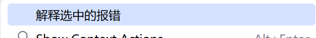
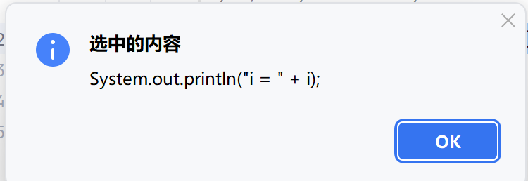
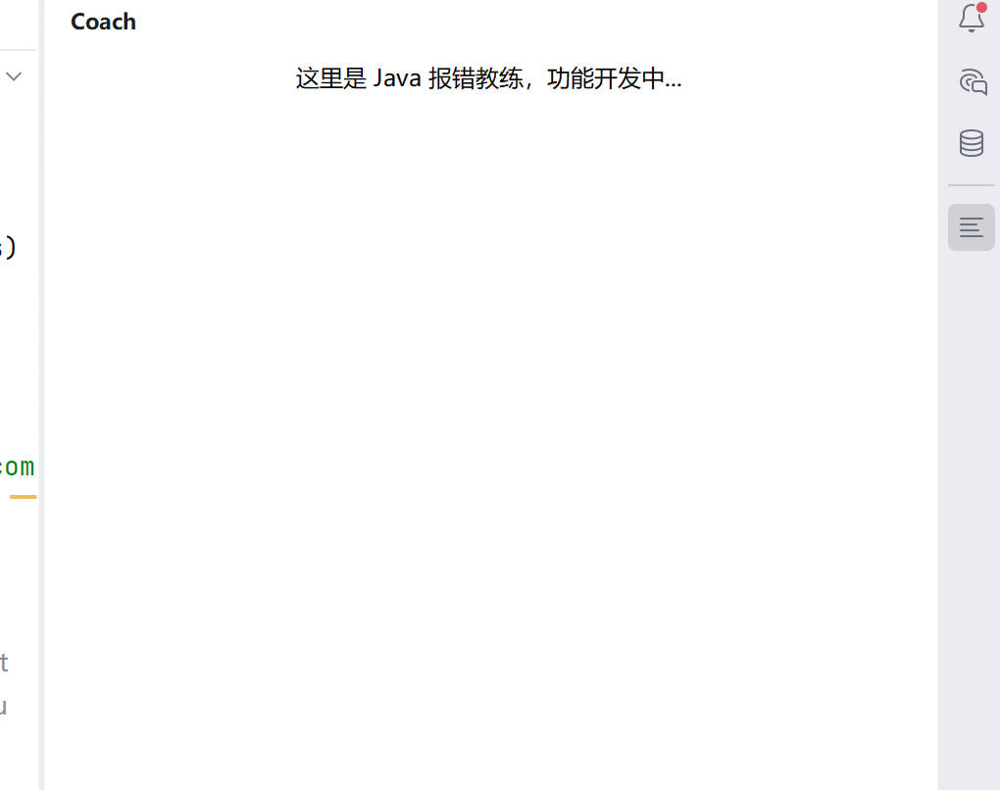

2026.11.14

dsh不小心把一些工作一步到位了,而这些恰巧是这个项目的一个关键点,我一开始有点不知道我要做什么,跳过了什么.后来花了一点时间终于理解了.

runlde跑通了,沙箱里可以看见自制插件.

尝试将功能加入右键菜单

resources下没有东西,找不到xml文件

尝试新建**`META-INF`**目录,**`plugin.xml`**自己显示出来了

进行测试

1.新建java项目以及文件

 选择文本右键

        

点击

功能正常

dsh发布了新任务:让面板出现在右边    

成功了

尝试在报错中显示选项

    失败了

   修改action

      <actions>
        <action id="Coach.ExplainSelection"
                class="com.caixht.coach.action.ExplainSelectionAction"
                text="解释选中的报错">
          <add-to-group group-id="EditorPopupMenu" anchor="first"/>
          <add-to-group group-id="ConsoleEditorPopupMenu" anchor="first"/>
        </action>
      </actions>       

<actions>
    <action id="Coach.ExplainSelection"
            class="com.caixht.coach.action.ExplainSelectionAction"
            text="解释选中的报错">
      <add-to-group group-id="EditorPopupMenu" anchor="first"/>
      <add-to-group group-id="ConsoleEditorPopupMenu" anchor="first"/>
    </action>
  </actions>

<actions>
    <action id="Coach.ExplainSelection"
            class="com.caixht.coach.action.ExplainSelectionAction"
            text="解释选中的报错">
      <add-to-group group-id="EditorPopupMenu" anchor="first"/>
      <add-to-group group-id="ConsoleEditorPopupMenu" anchor="first"/>
    </action>
  </actions>

  注册成功了

dsh:进行接入程序

   成功建立通道了

评:弹窗太小了,同时先进行报错分析才展示文本.
